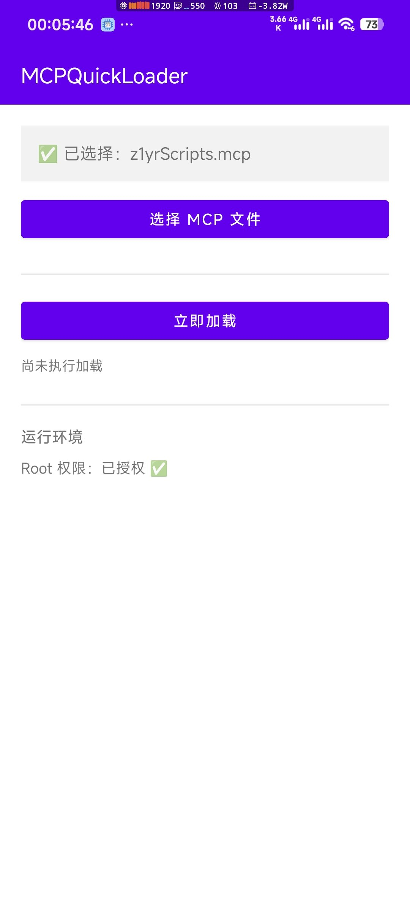
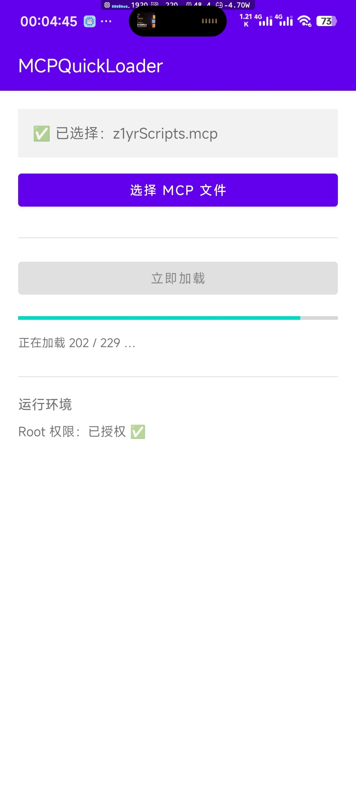

# MCPQuickLoader

把 `.mcp` 模组文件**批量投放**进网易《我的世界》客户端缓存目录的安卓小工具。

需要 **Root**（Magisk / KernelSU 都可以）。**不需要** LSPosed / Xposed。

---

## 它解决什么问题

网易版《我的世界》把模组（`.mcp`）缓存在应用私有目录里，**位置可能是下面两个之一**（不同设备、不同安装方式会不一样）：

```
/data/user/0/com.netease.x19/files/games/com.netease/packcache/<随机名>/                      ← 内部存储
/storage/emulated/0/Android/data/com.netease.x19/files/games/com.netease/packcache/<随机名>/   ← 外部存储
```

程序会两个都试；都不存在时，再自己搜索 `packcache` 目录。

两个麻烦事：

1. 这是**应用私有目录**，普通文件管理器根本进不去，只有 root 或游戏自己才能写；外部存储那一侧还额外需要「所有文件访问权限」；
2. `packcache` 下面有一大堆**随机命名**的子目录，而且**每进一次游戏还会继续新增**，游戏从哪一个读是随机的 —— 手动一个个塞进去基本不现实。

MCPQuickLoader 做的事很简单：**你选一次 `.mcp`，点一下按钮，它用 root 把文件复制进每一个子目录**，并且把文件的属主、权限、SELinux 标签都修正成和游戏自己写出来的一样，保证游戏能正常读取。

## 界面

主界面 —— 会记住上次选的文件，App 被后台清掉重开也还在：



加载中 —— 进度条实时显示投放进度（截图里是 202 / 229，这个总数会随游戏每次启动变化）：



## 使用步骤

1. 手机上安装并打开 App；
2. 先确认界面下方「**Root 权限**」和「**所有文件访问权限**」都是 ✅（后者不是就点那一行去授权）；
3. 点「**选择 MCP 文件**」，挑一个 `.mcp` 文件（选完会记住，下次不用再选）；
4. 点「**立即加载**」——第一次会弹 root 授权框，**点允许**；
5. 等进度条跑完，看到「已复制到 N 个子目录」就成功了；
6. 进游戏即可。

## 工作原理

| 步骤 | 做了什么 |
| --- | --- |
| 选文件 | 用 `ActivityResultContracts.OpenDocument()` 拉起系统文件管理器。`.mcp` 不是标准 MIME 类型，所以放开 `*/*` 再校验后缀 |
| 记住选择 | 调 `takePersistableUriPermission()` 申请**长期**读取权限（少了这步，App 一重启那个 `content://` 就失效），再把地址写进 `/sdcard/Android/data/<包名>/files/selected_mcp.txt` |
| 落地文件 | 把选中的文件读出来写进外部缓存目录，得到一个 root 也能访问的真实路径 |
| 定位游戏目录 | 依次检查内部存储、外部存储两个候选路径；都不存在时用 `find` 搜索 `packcache` |
| 投放 | `su` 执行一段 shell，遍历 `packcache/*/`，对每个子目录：`cp -f` 覆盖复制 → `chown` 改成与目录相同属主 → `chmod 766` → `restorecon` 修正 SELinux 标签 |
| 进度条 | 脚本每处理完一个目录就 `echo "PROGRESS\|已完成\|总数"`，Kotlin 侧用 `bufferedReader().forEachLine` **边执行边读**，实时刷新 |

其中 `chown` / `chmod` / `restorecon` 三步是关键：只是把文件拷进去，游戏会因为属主不对或 SELinux 标签不匹配而读不到。

另外，程序启动时会自动检测 `su --mount-master` 是否可用并优先使用 —— 部分 root 方案（如 KernelSU）下，App 自己的挂载命名空间看不到游戏的数据目录，只有全局命名空间才看得见。

## 诊断日志

每次加载的全过程都会写进：

```
/sdcard/Android/data/com.z1yr.mcpquickloader/cache/z1yr-debug.log
```

内容包括版本、机型、系统版本、root 与权限状态、选中的文件、落地路径、**完整执行脚本**、**shell 的全部原始输出**。加载失败时，诊断信息也会直接显示在界面上，截图即可反馈。

## 编译

- Android Studio（开发时用的是 2026.2.1，AGP 9.4.1 / compileSdk 37 / minSdk 26）
- 命令行编译安装：`gradlew installDebug`

> 如果你从 Android Studio 点 Run 部署，建议在 Run/Debug Configurations 里勾上
> **Always install with package manager (disables deploy optimization)**。

## 已知限制

- **必须 root**：目标目录属于游戏进程，不 root 写不进去；
- 会往**每一个**子目录各放一份，占用 = 文件大小 × 目录数；而目录数还会随游戏每次启动增长，所以体积大的模组会占掉可观空间（几百 KB 的包往往就是上百 MB）；
- 游戏包名写死为 `com.netease.x19`（网易版《我的世界》），其它版本需要自行修改；
- 只做了「投放文件」，不含任何游戏内功能。

## 关于创作

本项目由 **GDKK** 与 **DeepSeek** 共同创作完成：需求、功能设计和实机调试由作者完成，代码编写与文档撰写在 **DeepSeek（DeepSeek Harness）** 的辅助下进行 —— 也就是一份 **AI 辅助创作**的作品。

## 开源协议

[MIT License](LICENSE)
